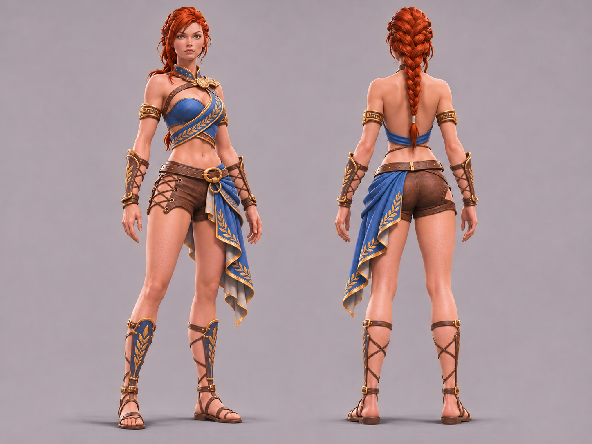

# Hilda Outfit Redesign — дизайн-контракт D и исследование донорских ассетов

**Актуально на 2026-11-04.** **Обновление художественного отбора:** F2 — *Athenian Adventurer* принят пользователем как текущий художественный фаворит для следующего сравнения; исходный D остаётся архивным утверждённым эталоном, не заменён.  Единая точка входа для возобновления проекта переработки костюма Хильды из *Asterigos: Curse of the Stars*. **Статус:** художественное направление **D (Refined Final Hybrid)** принято как рабочая основа; **игровой мод D не создан**, техническая реализуемость и точные игровые ресурсы не исследованы. Исходные решения фиксируются здесь, а не в настройках ChatGPT Project.

> **Важно:** это документ о дизайне и плане исследований, а не подтверждение редактируемости конкретных мешей. Не переименовывать художественные гипотезы в факты. Канонические cross-mod сведения об окружении — [VERIFIED_RUNTIME.md](VERIFIED_RUNTIME.md), общая техника — [MODDING_EVIDENCE.md](MODDING_EVIDENCE.md). Для отдельного будущего мода его собственные исходники, статус и приёмка должны принадлежать его репозиторию.

## Канонические изображения — архивированная версия D

**Семь исходных PNG теперь сохранены в этом репозитории и проверены побайтово по Git blob SHA-1 относительно исходного пакета.** См. [каталог с контрольными суммами](assets/hilda/README.md) и [последний утверждённый рендер D](assets/hilda/06-D-Final-open-back.png).

**Приоритет изображений:** именно `06-D-Final-open-back.png` определяет нынешний силуэт; `00`–`05` — история сравнений, а не альтернативные текущие задания. Рендер — **художественный эталон**, не импортируемый skeletal mesh. Небольшие корректировки геометрии шорт остаются возможным будущим улучшением, не автоматическим изменением дизайна.

## 1. Принятая художественная цель

Сделать стартовый «Наряд Северного Ветра» (Northwind Attire; не путать с иными предметами и DLC) **более женственным, привлекательным и выразительным**, сохранив узнаваемую Хильду и художественный язык Asterigos. Не «чем меньше одежды, тем лучше»: привлекательность задают **крой, асимметрия, контраст открытой кожи с тканью/кожей/бронзой и вид со спины**. Практичность — не абсолютный приоритет, но исключены абсурдные решения вроде каблуков, боевого бикини, полностью незащищённых стоп и парадного платья.

**Визуальная опора:** исходный дизайн игры + существующий мод на стандартный наряд с укороченным синим топом и кожаными шортами + серия концептов Variant 3 → A/B/C → D. Внешность: узнаваемые игровые лицо/пропорции, рыжие волосы с характерной косой; не заменять случайной «фэнтезийной моделью».

### Канонический вариант D (последняя принятая визуальная итерация)

- **Перед:** облегающий **асимметричный диагональный синий верх**, открыты ключицы, плечи и живот; красивое, но конструктивно правдоподобное декольте. Заметный античный **бронзово-золотой растительный мотив вдоль синей диагонали**, одна выразительная застёжка/фибула возле ключицы. Это **не** обычный прямоугольный crop top, не отдельный бюстгальтер и не набор броневых чашек.
- **Спина — принципиально важно:** верхняя и средняя части спины **открыты полностью**, рыжая коса — главный вертикальный акцент. **Нет двух перекрещивающихся ремней, кольца между лопатками и дополнительных плечевых/спинных перемычек.** Допустима только низко расположенная горизонтальная/обёрнутая синяя полоса, удерживающая низ верха, как на последней принятой визуализации. Это **последнее решение пользователя**, заменяющее раннее предпочтение симметричной X-образной спины варианта B.
- **Плечи:** не дублировать ошибку предыдущего turnaround, когда с переднего ракурса плечо голое, а с заднего внезапно появляется наплечник. Оба ракурса должны показывать **те же открытые плечи**, без внезапных броневых накладок; небольшие бронзовые обручи на верхней части рук остаются.
- **Шорты:** короткие облегающие кожаные, закрывают таз и ягодицы; **один наружный боковой вырез со шнуровкой и заметными бронзовыми люверсами**. Минимум массивных металлических окантовок и лишних пряжек: шорты — прежде всего одежда. Округлые/полукруглые непонятные передние кожаные контуры раннего D — дефект для возможной дальнейшей полировки, **не новая обязательная деталь**. Не делать из шорт бельё.
- **Талия:** функциональный кожаный пояс с красивой, но не чрезмерно массивной бронзовой пряжкой; не размножать ремни и подвески.
- **Синяя драпировка:** одно выразительное асимметричное полотнище **на одном физическом боку** с красивыми античными складками, заметной бронзовой окантовкой/лавровыми мотивами и изредка видимой светлой изнанкой. Не превращать в юбку, задний плащ или передник; не скрывать большую часть ног/ягодиц. Передний и задний ракурсы должны показывать **одну и ту же анатомическую сторону крепления** (на изображениях она зеркально меняется относительно зрителя).
- **Наручи:** снаружи узкие защитные кожано-бронзовые пластины с выразительной, но не сплошной отделкой; **изнутри открытая кожа и редкая функциональная шнуровка**. Не делать монолитные бронзовые трубы.
- **Обувь/поножи:** высокие **античные сандалии-гибриды** с плоской прочной подошвой, открытой пяткой/частями голени, редкой перекрёстной шнуровкой сзади/изнутри; спереди/снаружи узкая кожаная защита с синим полем и ограниченным бронзовым узором. Не возвращать однотонные массивные сапоги. Левая/правая конструкции должны быть согласованными.
- **Палитра:** благородный насыщенный синий, тёплая коричневая кожа, заметная тёплая бронза/золото как акцент, иногда светлая изнанка ткани. Бронзовая отделка в C понравилась пользователю **именно своей выразительностью**: не упрощать костюм до скучной утилитарной кожи, но сохранять спокойные поверхности без мелкой фурнитуры.
- **Форма и читаемость:** лицо и верх → талия/синяя боковая драпировка → открытые ноги и сандалии → наручи. Античный мотив не следует повторять с одинаковой плотностью на каждой детали. Основной игровой вид — **сзади**, ему уделять не меньше внимания, чем виду спереди.

### История выбора (только существенные решения)

| Этап | Что доказал/дал | Статус |
| --- | --- | --- |
| Стандартный Northwind + существующий crop-top/shorts мод | Есть узнаваемые кожаные и металлические элементы; простое снятие одежды делает образ похожим на Лару Крофт, но не достаточно выразительным | Исходное сравнение |
| Первоначальный «Variant 3 — Graceful Fantasy Heroine» | Асимметричный синий верх и ткань у бедра формируют нужный художественный язык | Исходник концепта |
| A — Elegant Adventurer | Чистый крой, облегчённые сандалии и наручи, боковая шнуровка | Сравнительный концепт |
| B — Sensual Adventurer | Более выразительный силуэт и открытость, удачные короткие шорты, лёгкая драпировка; пользователю особенно нравилась симметричная открытая спина | Сравнительный концепт |
| C — Ornate Adventurer | Бронзовые защитные акценты, фибула и более заметная вышивка на синей ткани; пользователь предпочёл общий характер C, хотя счёл фурнитуру на шортах потенциально избыточной | Сравнительный концепт |
| D1/D2 — Refined Final Hybrid | Взята лёгкость B, античная отделка C, согласованы короткие шорты, шнурованные элементы, открытые плечи | Рабочий целевой концепт |
| Последняя точечная правка D | **Убраны X-образные ремни и кольцо со спины, остальная композиция сохранена** | **Текущий художественный ориентир** |

Не интерпретировать рейтинги ассистента как объективную художественную оценку или техническую приёмку.

## 2. Реальные костюмы, предложенные как доноры

Названия «гладиатор», «туника», «фехтовальщица», «киберпанк», «викинг» в данном разделе — **рабочие подписи пользователя**, а не подтверждённые официальные названия предметов. Не придумывать технические asset paths по ним.

| Условное имя | Референсы пользователя от 2026-11-04 | Возможный донор / ограничение |
| --- | --- | --- |
| **Северный Ветер** (стандартный стартовый костюм) | «Оригинальный дизайн(1).png», фронт+спина | Синий цвет, полы туники, ремни, наручи, сапоги; не известно, отдельные ли это меши |
| **Гладиатор** | «ОД_гладиатор_спереди(1).png», «ОД_гладиатор_сзади(1).png», плюс игровые/промоизображения | Короткий верх, открытое тело, бронзовая защита, сандалии/поножи; точная форма D отличается |
| **Туника** | «ОД_туника_спереди(1).png», «ОД_туника_сзади(1).png» | Драпировка, складки, окантовка, свободный край; подвижность и скелетная привязка неизвестны |
| **Фехтовальщица** | «ОД_фехтовальщица_спереди(1).png», «ОД_фехтовальщица_сзади(1).png» | Конструкции защитных элементов и шнуровки; белая одежда/асимметричная тяжёлая броня в D не нужны |
| **Киберпанк** (мод на другой костюм) | «МД_киберпанк_спереди(1).png», «МД_киберпанк_сзади(1).png», плюс «image(6).png» | Короткий открытый верх, видимое тело/спина, иной тип ремней и обуви; не копировать современный стиль |
| **Викинг** | «image(4).png» | Возможные декоративные броневые мотивы; низкий приоритет из-за иной пластики |
| **Paragon Armor** | «image(7).png» | Металлические акценты, не брать цельный тяжёлый нагрудник |

**Гипотеза донорской сборки (не решение о реализации):** использовать *Shorts Armor Type 1* как первоначальную платформу; изучить открытое тело из Nude Hilda, драпировку из Северного Ветра/туники, защиту ног из «гладиатора», наручи/фурнитуру из имеющихся комплектов. Комбинирование разных skinned meshes **не доказано**.

## 3. Nude Hilda / d00m92 — что реально известно

**Доказательство пользователя:** представлены рендеры модов Nude Hilda, Shorts Armor, Shorts + Crop Top, Arcanic Phantom Mantle и Bikini Armor. Показаны полнотелые модели (разные силуэты Slim/Regular/Curvy), альтернативные материалы/текстуры кожи и несколько способов изменять одежду. Это доказывает **существование соответствующих визуальных результатов**, а не доступность исходных проектов или конкретной процедуры импорта.

**Наблюдение пользователя (2026-11-04):** на его компьютере **установлены и работают Shorts Armor Type 1 и Arcanic Phantom Mantle Type 1 с обычной причёской Хильды**. Установленная версия игры/точные имена активных пакетов/контрольные хэши ещё не сняты. Не путать это с технической верификацией совместимости со всеми другими модами.

**Из прежнего разговора (2026-10-24; пересказ присланного описания автора, не повторная проверка оригинальной страницы):**
- Автор/атрибуция: **d00m92**; первоначальная коллекция упоминалась как **Nude Hilda**. В истории также встречалось имя **2BLaraSex** — не делать без источника вывода, что это обязательно тот же автор/аккаунт.
- Упоминались сборки/варианты Bikini Armor (27.05.2023), Shorts + Crop Top (01.06.2023), Arcanic Phantom Mantle (11.06.2023); архив **v1.5.0 / 11.06.2023** — только историческая отметка, не «последняя версия» на сегодня.
- Были варианты пропорций тела, внешнего вида кожи, причёсок, опции *No Scabbard* и комплекты с физикой/без физики.
- В прежнем описании установки назывался каталог `Genesis\Content\Paks\~mods` и согласованные группы `.pak`, `.utoc`, `.ucas`; отдельные текстурные пакеты (в частности `pakchunk101-WindowsNoEditor_P`) могут конфликтовать. Это **историческая инструкция**, а не подтверждённая инвентаризация установленной игры.
- Отмечались возможные проблемы физики, свечение кожи в катсценах и сохранение «броневых» звуков шагов. Не приписывать им причины без диагностики.
- В старых инструкциях встречалась зависимость от mod-enabled EXE; необходимость именно для текущей установленной сборки **не подтверждена**. Ничего не менять в EXE автоматически.
- Замены одного и того же слота/ресурса могут конфликтовать; разные имена архивов не гарантируют независимости.
- **Точные инструменты, исходники автора, pipeline export/reimport, mesh names, права на переработку/перераспространение и исходная страница Nude Hilda не установлены.** Не выдавать Blender/UnrealPak/конкретный importer за подтверждённый путь.

**Внешняя зацепка:** публичный [XNALara/XPS-порт Arcanic Phantom Mantle](https://www.patreon.com/dddkhakha1/posts/hilda-arcanic-of-85048378), опубликован 24.06.2023, указывает «Model by d00m92; Port by me». Это **публикация о стороннем порте**, не исходный проект автора и не доказательство обратного импорта в игру. Происхождение, лицензии и пригодность донорских моделей проверять отдельно.

### Подписи к пользовательским превью модов

- `Preview.jpg` — Nude Hilda: Clean/Dirty, Shaven/Hairy1/Hairy2, Slim/Regular/Curvy; наличие полной видимой геометрии в конкретном рендере, не гарантия общего игрового body mesh.
- `Previews.jpg` — **Shorts Armor Type 1–4**: модификации коротких шорт/верха/защитных элементов.
- `Previews(1).jpg` — Arcanic Phantom Mantle с вариантами одежды и optional braided hair.
- `Preview(1).jpg` — Arcanic Phantom Mantle с обычной причёской, фронт/спина.
- `Previews(2).jpg` — **Shorts + Crop Top Type 1–4**: разные комбинации топа, пояса, наручей и шорт.
- `Previews(3).jpg` — Bikini Armor Type 1–4: технический пример степени удаления одежды, **не** целевой художественный стиль.

**Визуальные материалы:** все семь собственных концепт-рендеров Variant 3/A/B/C/D **уже находятся в репозитории** в [docs/assets/hilda](assets/hilda/README.md), включая точный [утверждённый D](assets/hilda/06-D-Final-open-back.png). Оригинальные игровые скриншоты пользователя, официальные промоизображения и превью стороннего Nude Hilda **здесь не размещены**: их названия и художественная/техническая роль описаны в этом документе, но права на публичное размещение не проверены. **Не добавлять сторонние игровые ассеты/изображения автоматически.**

## 4. Техническая реализуемость: утверждения и неизвестные

| Что известно | Источник / уровень | Чего **не** следует выводить |
| --- | --- | --- |
| Пользователь видит и запускает Shorts Armor Type 1 и Arcanic Phantom Mantle Type 1 | Пользовательское runtime-наблюдение | Совместимость этих мешей/материалов с новым D, конкретные версии и имена ресурсов |
| Nude Hilda демонстрирует тело и различные разрезанные костюмы | Пользовательские рендеры; внешняя модификация | Наличие универсального полного тела под каждым нарядом |
| В Asterigos используются замены игровых ресурсов и UE4SS-моды | См. [MODDING_EVIDENCE.md](MODDING_EVIDENCE.md) | Наличие готового редактора костюмов, правильных экспортных настроек, успешного reimport в текущем билде |
| Research baseline Steam 1.09/build 12996889, UE4.27 | [AGENTS.md](../AGENTS.md) и [VERIFIED_RUNTIME.md](VERIFIED_RUNTIME.md) | Что версия текущей пользовательской установки уже замерена и совпадает |

**Главные неизвестные:** пути/хэши `.pak/.utoc/.ucas`; игровые слоты, skeletal meshes, их sections, materials, skeleton и LOD; наличие тела под одеждой; vertex weights, seams, normal/tangent data; cloth physics/кинематика синего полотнища; взаимодействия с оружием, анимациями, катсценами и другими косметическими заменами; легальность заимствования сторонних моделей/текстур.

## 5. Следующий ограниченный технический этап

**Цель:** получить подтверждённую карту пригодных доноров для **D**, не меняя установленную игру.

1. Прочитать актуальные [DevRules](https://github.com/NikichMods/DevRules), этот контракт и [RESEARCH_INDEX.md](RESEARCH_INDEX.md); исследование на машине проводить через локальный Codex с его отдельным workflow.
2. В **read-only** режиме инвентаризовать **фактически установленные** мод-пакеты: пути, названия, активные группы расширений, контрольные суммы, версии и слот заменяемого наряда; отдельно определить файловые конфликты Shorts Armor и Arcanic Phantom Mantle. Не копировать большие игровые/сторонние бинарники в GitHub.
3. Выяснить доступный по реальным файлам и установленным инструментам путь просмотра/экспорта ресурсов; доказать точные владельцы геометрии верха, тела, шорт, синей ткани, наручей и обуви. Не предполагать инструмент по умолчанию.
4. Составить **матрицу доноров с точными asset identifiers и доказательствами**: reuse as-is / texture-only / mesh trim / mesh edit + skinning / not feasible. При сомнениях проверять small-scope экспорт/рендер **отдельно от рабочей установки**.
5. Сравнить 2–3 реально подтверждённых пути сборки (из одного исходного костюма, пересборка частей, статические косметические замены) по трудоёмкости, рискам коллизий и анимаций; выбрать минимальный достаточный.
6. Только затем планировать отдельный мод и его production gates, тесты полного набора анимаций/катсцен/LOD и приёмку. Не обещать точный срок или простоту до доказательств.

**Критерий завершения исследования:** каталог проверенных файлов/asset IDs с точными источниками и матрица, позволяющая обоснованно оценить D, **без изменений рабочей установки и без заявлений о готовом игровом костюме**.

## 6. Восстановление визуализации из утверждённого изображения D

Использовать сохранённый [последний D](assets/hilda/06-D-Final-open-back.png) (два полноростовых ракурса, нейтральный серый фон) как **главный изображенческий референс**, а оригинальные игровые скриншоты — для игрового облика. При редактировании **менять только названную деталь** и проверять перед/спину как одну физическую конструкцию.

Краткий контрольный промпт для реконструкции идей, **не заменяет изображение**:

> Hilda from Asterigos: Curse of the Stars; front three-quarter and exact back full-body matching stylized 3D turnaround, light neutral background. Refine the existing blue/bronze/brown Northwind-derived light adventurer outfit, not a wholly new costume. Elegant asymmetrical blue diagonal wrap crop top with ornate but focused bronze leaf embroidery, open shoulders and midriff, one functional bronze clasp; **fully exposed bare upper and middle back, absolutely no X-shaped back straps or central back ring**, only the low blue supporting band. Short brown leather shorts with one side lace-up cutout and bronze eyelets, no excess metal edging or odd semicircular front patch. One same-side flowing blue hip drape with bronze laurel trim and pale lining. Exterior protective leather-bronze bracers with open interior lacing; flat high gladiator sandals, front/outer blue-inlaid shin guards, open laced calves. Keep characteristic braided red hair, proportions, coherent matching armor and garment topology across views. No high heels, bikini, cloak, added asymmetrical shoulder armor, design poster, labels or extra props.

### Возобновление из одного источника

Новый чат или локальный Codex должен начать с **этого файла**, затем пройти по ссылкам [RESEARCH_INDEX.md](RESEARCH_INDEX.md), [MODDING_EVIDENCE.md](MODDING_EVIDENCE.md), [VERIFIED_RUNTIME.md](VERIFIED_RUNTIME.md). Принятый внешний вид D и известные доноры описаны выше. Для пиксельной/визуальной работы открыть **[точный D в GitHub](assets/hilda/06-D-Final-open-back.png)** и при необходимости [галерею предыдущих этапов](assets/hilda/README.md); **не реконструировать изображение по памяти**. Отсутствуют только снимки игры и превью сторонних модов, для которых отдельно нужны законные источники.

## 7. Параллельные художественные итерации E/F/G (начаты 2026-11-04)

**Статус:** поиск более цельного баланса открытых и закрытых участков; **принятый эталон D выше не заменён**. Новый выбор касается художественных сравнений, не реализации мода.

### F1 — Athenian Adventurer, первая визуальная итерация

**Зафиксировано по явному решению пользователя 2026-11-04:** первое изображение **F1** сохранено как исходная визуальная итерация направления F, **не** как окончательно утверждённый костюм. Полноразмерный PNG доступен в чате и отдельным файлом для скачивания под именем \`Hilda-F1-Athenian-Adventurer.png\` (1536×1024, SHA-256 \`463eb292bc8dd7c2548130363c280a9ae6b415081f26950529fa661fee30c22c\`). **Этот PNG пока не загружен в GitHub; ссылка на него не должна подменяться выдуманным путём в репозитории.**

Идея F: удлинённый облегающий диагональный синий верх до пояса, бронзовый лавровый мотив, **маленький асимметричный вырез у талии** вместо сплошь открытого живота, открытая спина без X-ремней и кольца, конструктивное удержание верха на талии, аккуратные кожаные шорты, прежняя синяя боковая драпировка, наручи и лёгкие поножи/сандалии.

**Оценка F1 как первого эксперимента, не новая спецификация:** асимметричный промежуток кожи получился более крупным, чем задумано; высокий ворот может утяжелять верх. Сохранять F1 как точку сравнения, не считать эти особенности обязательными для F2.

### E — Refined D, следующий визуальный эксперимент

**Задание:** сделать минимальную полировку последнего D, не используя новую конструкцию F:
- сохранить диагональный синий топ, открытую спину без X-ремней, оригинальную лицевую форму Хильды и рыжую косу;
- **слегка** удлинить топ, оставив узкую горизонтальную/естественную полосу открытого живота; **не** превращать его в закрытый до пояса верх F;
- привести шорты к нормальной средней посадке, убрать странные полукруглые накладки/избыточную фурнитуру, слегка выровнять и удлинить штанины, оставить **одну** боковую шнуровку;
- сохранить одну синюю драпировку на том же физическом боку в двух ракурсах; оставить выразительные лавровые бронзовые акценты, наручи с открытой внутренней шнуровкой и плоские шнурованные сандалии с лёгкими поножами;
- **строго согласовать перед и спину** как одну конструкцию; одинаковые пропорции, свет и ракурсы с D/F для честного сравнения.

**Задача этапа:** сначала получить E, затем сопоставить E и F1 без автоматического изменения канонического D. Реальная доступность мешей, skinning/LOD/cloth pipeline остаётся непроверенной согласно разделам 4–5.

### E1 — Refined D: независимая визуализация

**Статус:** создано изображение E1 в отдельном чате, затем предоставлено пользователем для сравнения 2026-11-04. Художественный результат: слегка удлинённый диагональный синий верх с открытым животом; почти полностью открытая спина с низким задним V-образным завершением; аккуратные кожаные шорты со шнуровкой, длинная синяя асимметричная драпировка, сандалии и наручи. Сравнивать как самостоятельную альтернативу, а не промежуточную часть F.

Идентификация пользовательского изображения: `image(8).png`, 1448×1086, SHA-256 `8074346e5b1087026d5cc51f83cfecc858f99248ebda649b5706b54b00031dc9`. Это **прикреплённый в чате оригинал**, бинарный PNG **не сохранён в репозитории**.

### F2 — Athenian Adventurer: принятый художественный фаворит

**Решение пользователя 2026-11-04:** **F2 принят как текущий художественный фаворит**, но **не утверждён как финальный игровой костюм**; следующий шаг — сравнить с G1. Архивный D не заменяется и остаётся неизменным. Замечание о высоте воротника отложено; не менять воротник автоматически ради нового сравнения.

**Идентификация изображения F2:** второй из двух прикреплённых пользователем независимых рендеров E/F, `image(9).png`, 1448×1086, SHA-256 `1503d2599527ad1c00bc3dbe646485db9a076ff2ed7efa476afdb0bb2933719a`. Изображение **пока не находится в GitHub**, не подменять его описанием/придуманным asset URL.

**Подтверждённые по рендеру художественные особенности F2:**
- Перед: длинный облегающий синий асимметричный лиф с бронзовым лавровым диагональным акцентом; большая часть живота закрыта, **небольшой асимметричный вырез кожи сбоку у пояса**; высокий синий воротник с одной бронзовой фибулой.
- Спина: большая открытая зона, обрамлённая боковыми синими панелями с V-образным сведением к поясу; X-ремней и центрального кольца нет; рыжая коса остаётся вертикальным акцентом.
- Средняя посадка коричневых кожаных шорт с одним боковым участком шнуровки, длинная синяя драпировка **на одном и том же физическом боку** спереди и сзади, бронзовая окантовка.
- Лёгкие кожано-бронзовые наручи, поножи и плоские шнурованные сандалии; синий/коричневый/бронзовый.
- Главный плюс F2 относительно E1 — целостный перед и **конструктивно обрамлённая открытая спина**. Различия шорт и обуви между E1/F2 незначительны.

### G1 — Northwind Reforged: следующий сравнительный эксперимент

**Статус: только художественное задание, визуализации ещё нет.** Задача — сделать самостоятельный конкурентный силуэт, **не** перекрасить F2 и не копировать его облегающий длинный лиф с диагональной бронзовой полосой.

Основа языка форм — оригинальный Northwind (сочленение передней ткани с боковыми полотнищами), короткие элементы модифицированного Northwind/Shorts Armor, пластика драпировки туники и лёгкие элементы защиты из костюма «гладиатор». Главная новизна: **античное драпированное перекрытие двух текстильных деталей на верхе**, подчёркнутая талия и осмысленный переход к единственному боковому полотнищу; аккуратные короткие кожаные шорты другого кроя, открытые ноги, большая открытая спина **без X-ремней**, однотипные ракурсы и студийное освещение для сравнения с E1/F2. Не переносить гладиаторский шлем/массивный асимметричный наплечник, цельную юбку, тяжёлую броню, длинные штаны или закрытые сапоги.

Референсы в порядке предпочтения: оригинальный Northwind и игровые виды Хильды (внешность/масштаб/общая конструкция), игровые виды туники и гладиатора (идеи текстиля/защиты), D (удачная палитра и драпировка), F2 (художественный уровень и ограничения, **не** конструкция для копирования).

**Ограничение:** реальная совместимость игровых мешей, возможность пересадки частей, редактирование веса вершин/cloth/LOD и повторный импорт остаются непроверенными; G — эскиз с оглядкой на доноров, а не доказательство реалистичного pipeline.

