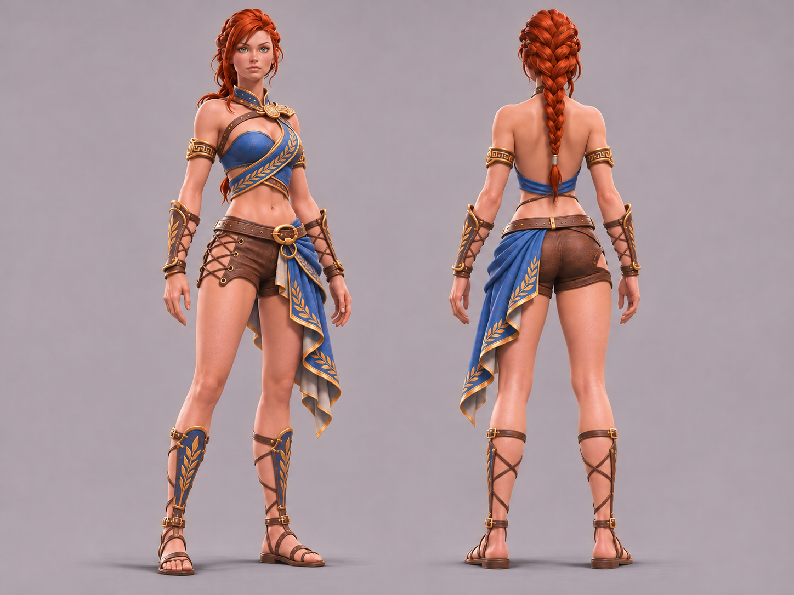

# Hilda Outfit Redesign — архив концепт-рендеров

**Статус на 2026-11-04: загружено и проверено 7 из 7 PNG в `main`.** Git blob SHA-1 и размер каждой загрузки совпадают с исходным архивом `Hilda-D-Reference-Pack.zip`; сигнатуры PNG в архиве проверены. Это **точное совпадение файлов**, а не художественная/геометрическая приёмка изображения.

**Основной визуальный источник для дальнейшей работы: [06-D-Final-open-back.png](06-D-Final-open-back.png).** Более ранние изображения — история сравнительных решений, **не** альтернативный нынешний контракт.

## Проверенный набор

| Файл | Назначение | Размер, байт | Git blob SHA-1 |
| --- | --- | ---: | --- |
| [`00-Variant-3-original.png`](00-Variant-3-original.png) | Главный исходный концепт | 3337266 | `2ea8912c4eaad7262ccab793cd4cb3c4989c899f` |
| [`01-A-Elegant.png`](01-A-Elegant.png) | Эксперимент A | 2693436 | `152be69cdee65b7fe0e49a137d99d75d46ef72bb` |
| [`02-B-Sensual.png`](02-B-Sensual.png) | Эксперимент B | 2677233 | `14f5fdbb423d86b0a2929f68c652095654010b32` |
| [`03-C-Ornate.png`](03-C-Ornate.png) | Эксперимент C | 3381979 | `5f423bb6880fac869bd33cea587d1213cdada289` |
| [`04-D-Initial.png`](04-D-Initial.png) | Первый гибрид D | 2649882 | `0ce2a306fcd466383f0daf2950d606cd10a93d48` |
| [`05-D-Shoulders-refined.png`](05-D-Shoulders-refined.png) | D после согласования плеч; ремни на спине ещё есть | 1903217 | `f03cc842a08e5cf892c343691ff41f4ae3f40c87` |
| [`06-D-Final-open-back.png`](06-D-Final-open-back.png) | **Текущий утверждённый художественный эталон D**: полностью открытая спина, без X-ремней | 1876381 | `087e1f3bfae24b2727fe6d42d194e7a2be6e91e2` |

## Как возобновить работу

1. Начать с [канонического дизайн-контракта D](../../HILDA_OUTFIT_REDESIGN.md).
2. Открыть [06-D-Final-open-back.png](06-D-Final-open-back.png) как главный визуальный референс, не заменяя его текстовым пересказом.
3. Использовать остальные шесть PNG только для сопоставления эволюции дизайна и отдельных решений. При новых редакциях сохранять утверждённую основу и согласованность переднего/заднего ракурсов.
4. Для technical modding отдельно исследовать реальные игровые ассеты, а не считать картинку готовой 3D-моделью.

Оригинальные пользовательские игровые скриншоты, промоизображения и превью стороннего Nude Hilda здесь **не размещены**; права на их публичное републикование не проверялись. Их описания и названия файлов находятся в [дизайн-контракте](../../HILDA_OUTFIT_REDESIGN.md). Не загружать чужие модели, архивы игры и текстуры без самостоятельного основания.
